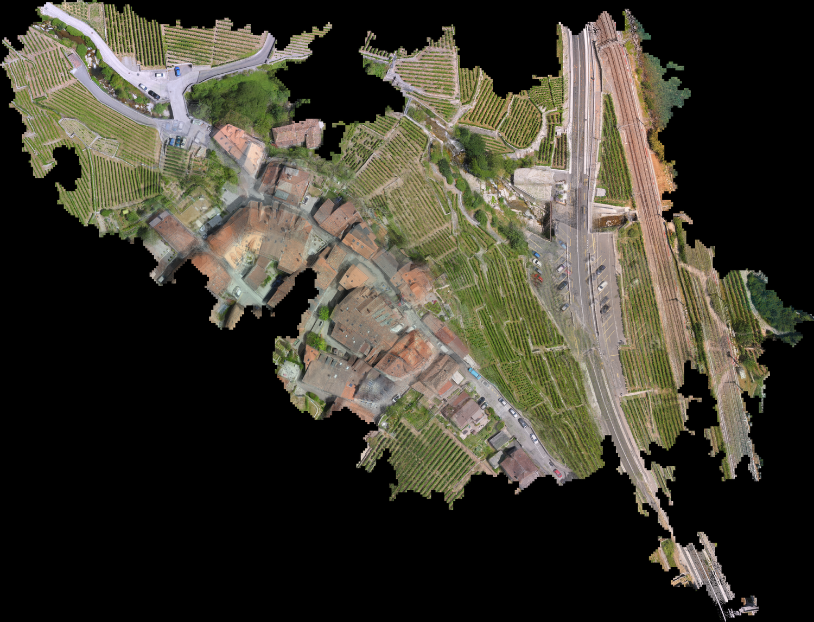
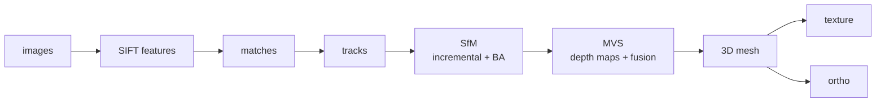
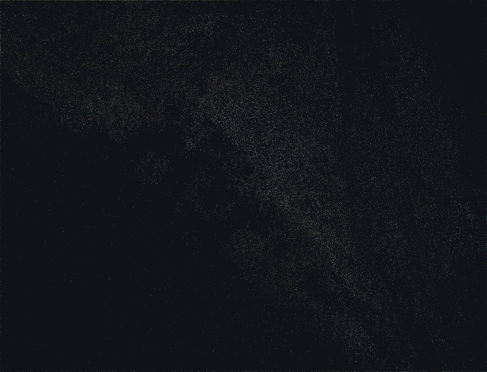
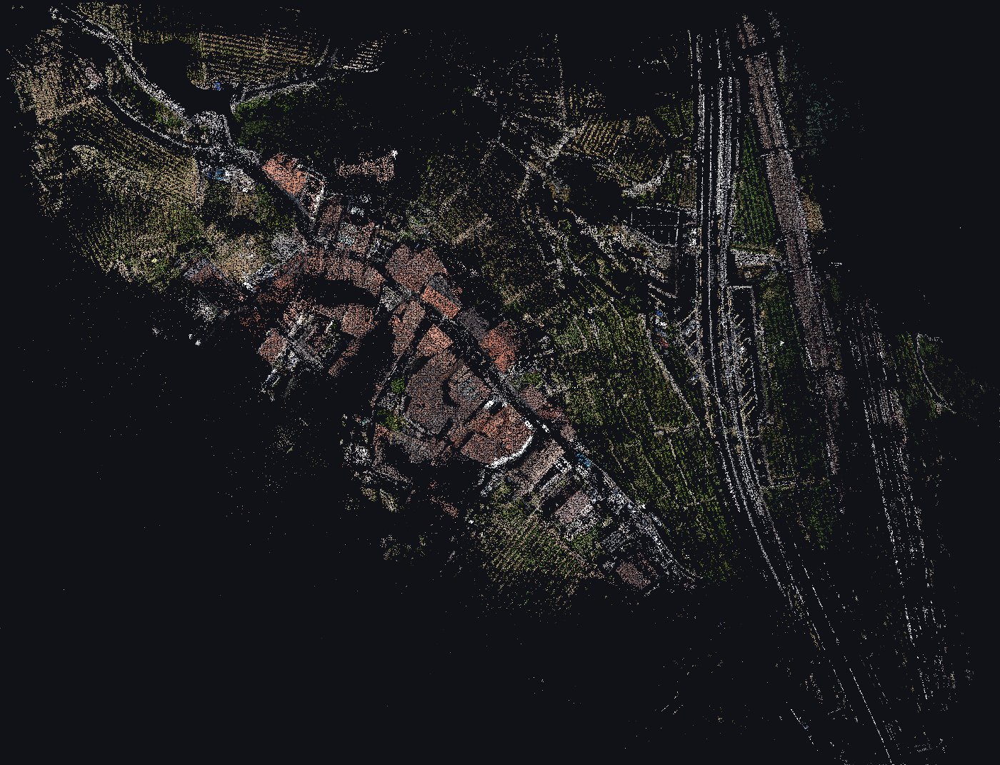
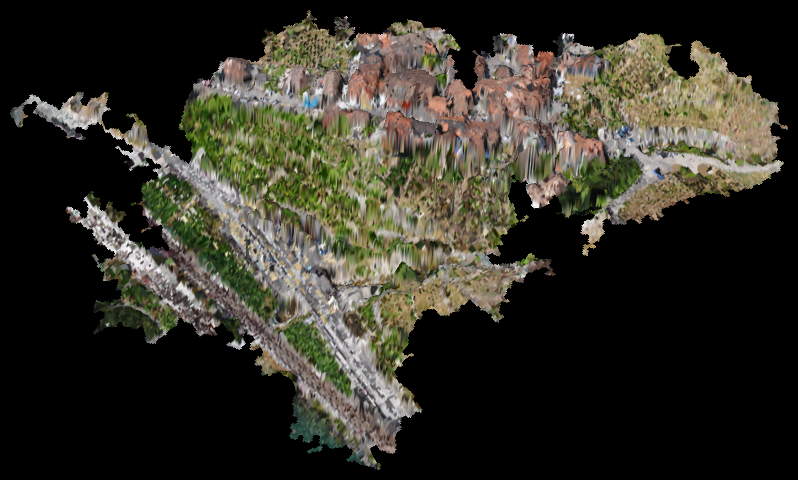
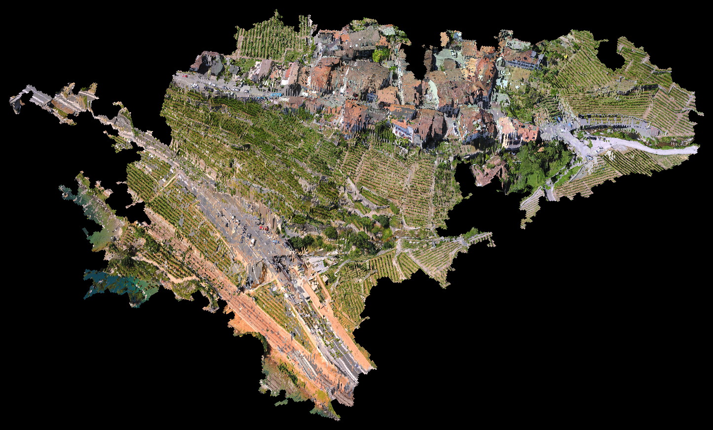

<p align="center">
  
</p>

<h1 align="center">owlrscon</h1>

<p align="center">
  <strong>A cross-platform photogrammetry pipeline in Rust, built on cubecl.</strong>
  <br>
  Turn a set of unordered aerial photos into camera poses, a sparse point cloud, a dense point cloud,
  a 3D mesh, a textured mesh, and a true orthophoto — automatically.
</p>

<p align="center">
  <a href="#license"></a>
  
  
  
</p>

<p align="center">
  <a href="README.zh.md">中文说明</a>
</p>

---

## ⚠️ Development status

> **This project is still under active development and is NOT production-ready.**
> The robustness, reconstruction accuracy, and outputs have not been systematically validated for
> professional surveying / engineering use. Do not use it for production tasks that require
> guaranteed measurement accuracy.

---

## About

**owlrscon** is a photogrammetry reconstruction pipeline written in **Rust**, built on
[**cubecl**](https://github.com/tracel-ai/cubecl). Starting from a set of unordered, overlapping
aerial photos, it automatically performs the full reconstruction chain:

```
features → matches → tracks → incremental SfM → dense MVS → mesh → texture → ortho
```



| Stage | Description | Output |
|---|---|---|
| `features` | SIFT feature extraction (GPU, via sift-cubecl) | feature descriptors |
| `matches` | pair-wise image feature matching | match pairs |
| `tracks` | multi-view track construction | tracks |
| `coverage` | coverage-graph visualization | `coverage_graph.png` |
| `sfm` | incremental Structure-from-Motion + bundle adjustment (BA) | `camera_poses.json`, `sparse.ply` |
| `mvs` | dense multi-view stereo: depth estimation + fusion | `dense.ply`, depth-map cache |
| `mesh` | surface reconstruction → 3D triangle mesh with vertex colors | `mesh.obj` |
| `texture` | UV atlas texturing → single textured model | `mesh_textured.glb` |
| `ortho` | true orthophoto (pull sampling + depth-map occlusion) | `ortho.tif` (GeoTIFF), `ortho_preview.png` |

---

## Results

The previews below come from a single aerial dataset (101 images, a ~14.9 × 11.4 m scene).
The raw demo images and intermediate files (`images/`, `*.ply`, `*.obj`, …) are gitignored;
only the previews under `docs/` are kept in the repo.

### 1. SfM — sparse point cloud

<p align="center">
  
  <br><em>Sparse point cloud (<code>sparse.ply</code>, 46,847 points) with photo-derived colors,
  reconstructed by incremental SfM.</em>
</p>

### 2. MVS — dense point cloud

<p align="center">
  
  <br><em>Dense point cloud (<code>dense.ply</code>, 245,884 points) after multi-view depth-map fusion.</em>
</p>

### 3. Mesh — 3D triangle mesh

<p align="center">
  
  <br><em>3D triangle mesh (<code>mesh.obj</code>, 50,437 vertices / 97,690 triangles) with vertex colors,
  shown as a tilted 2.5D view with relief shading.</em>
</p>

### 4. Textured mesh

<p align="center">
  
  <br><em>Textured mesh (<a href="mesh_textured.glb"><code>mesh_textured.glb</code></a>, ~35 MB) with the
  UV-atlas photo texture — open the file on GitHub for an interactive 3D view.</em>
</p>

### 5. Ortho — true orthophoto

<p align="center">
  
  <br><em>True orthophoto (<code>ortho.tif</code>, GeoTIFF, local coordinate system).</em>
</p>

---

## Why cubecl

All GPU compute in this project (SIFT, Census matching, dense depth estimation, fusion, …) is
written with **cubecl**: a `#[cube]` kernel is **written once** and compiles to multiple backends —
no need to maintain separate kernel sources per GPU / API.

| Backend | Under the hood | Notes |
|---|---|---|
| `wgpu` (default) | WGSL → Vulkan / DX12 / Metal | cross-platform; NVIDIA / AMD / Intel / Apple |
| `cuda` | CUDA | NVIDIA only (Windows / Linux) |
| `cpu` | pure Rust | any-platform fallback, no GPU required |

On top of that, the project pays special attention to **GPU memory safety** (one of its design
priorities):

- automatic VRAM probing: DXGI on Windows, `/sys/class/drm` on Linux, unified-memory on macOS;
- parallelism throttled by a per-task memory budget, so it won't OOM on 4 GB → 128 GB GPUs;
- automatic recovery from device loss (TDR / driver reset).

> ⚠️ The actively-tested path is `wgpu`; the `cuda` / `cpu` backends are wired up but less
> thoroughly verified.

---

## Platform & GPU support matrix

| OS | NVIDIA | AMD | Intel | Apple M-series |
|---|---|---|---|---|
| **Windows** | ✅ wgpu · ✅ CUDA | ✅ wgpu | ✅ wgpu | — |
| **Linux** | ✅ wgpu · ✅ CUDA | ✅ wgpu | ✅ wgpu | — |
| **macOS** | ⚠️ wgpu (Metal, legacy) · ❌ CUDA | ⚠️ wgpu (Metal, legacy) | ⚠️ wgpu (Metal, legacy) | ✅ wgpu (Metal, unified memory) |

Legend:

- ✅ **Supported** — backend available, compiles and runs;
- ⚠️ **Theoretically supported** — wgpu can go through Metal, but that hardware is discontinued and less verified;
- ❌ **Not supported** — CUDA no longer supports macOS;
- `wgpu` is the default backend (Vulkan / DX12 / Metal); `cuda` needs an NVIDIA GPU + CUDA; `cpu` is a pure-Rust fallback available on any platform.

> **Note**: Apple Silicon (M-series) is a unified-memory architecture, so the memory budget treats
> VRAM ≈ system RAM.

---

## Build & run

Prerequisites: Rust (edition 2024). The default backend is `wgpu`.

```bash
# default (wgpu, cross-platform)
cargo build --release

# NVIDIA CUDA backend
cargo build --release --no-default-features --features cuda

# CPU fallback (no GPU required)
cargo build --release --no-default-features --features cpu
```

Put your aerial photos in `./images`, then pick a stage:

```bash
# full pipeline
cargo run --release -- -dir=./images -stage=all

# stop after a stage
cargo run --release -- -dir=./images -stage=sfm
cargo run --release -- -dir=./images -stage=mvs      # default
cargo run --release -- -dir=./images -stage=mesh
cargo run --release -- -dir=./images -stage=texture
cargo run --release -- -dir=./images -stage=ortho
```

CLI arguments:

| Argument | Default | Description |
|---|---|---|
| `-dir` | `./images` | image directory |
| `-first_octave` | `0` | SIFT first octave |
| `-stage` | `mvs` | `features` / `matches` / `tracks` / `coverage` / `sfm` / `mvs` / `mesh` / `texture` / `ortho` / `all` |

---

## Project structure

```
src/
├── backend.rs    # cubecl backend selection, VRAM probing, parallelism throttling, device-loss recovery
├── matching.rs   # feature extraction (sift-cubecl) and pair-wise matching
├── tracks.rs     # multi-view track construction and coverage graph
├── sfm.rs        # incremental SfM + bundle adjustment (BA)
├── mvs.rs        # dense depth estimation + multi-view fusion (dense.ply)
├── mesh.rs       # surface reconstruction → mesh.obj
├── texture.rs    # UV atlas texturing → mesh_textured.glb
├── ortho.rs      # true orthophoto (GeoTIFF)
└── main.rs       # entry point and -stage dispatch
```

---

## License

This project is licensed under the [BSD 3-Clause License](LICENSE).

Copyright (c) 2026, Akimaylilll.

---

## AI-assisted development

This project was **developed with AI assistance (Claude)** — from the overall architecture and the
`#[cube]` GPU kernels to the implementation and debugging of each pipeline stage (SfM / MVS / mesh /
texture / ortho). Most of the code was written with AI assistance and then iteratively verified and
corrected by a human on real data, covering GPU-memory safety, cross-machine determinism, and
artifact removal.
