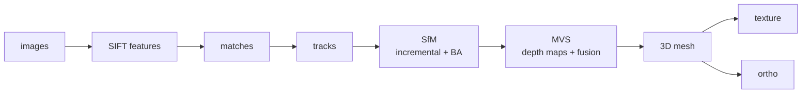

<p align="center">
  
</p>

<h1 align="center">owlrscon</h1>

<p align="center">
  <strong>基于 cubecl 的跨平台摄影测量流水线（Rust）。</strong>
  <br>
  从一组无序航拍照片自动重建出相机位姿、稀疏点云、稠密点云、三维网格、贴图网格与真正射影像。
</p>

<p align="center">
  <a href="#许可证"></a>
  
  
  
</p>

<p align="center">
  <a href="README.md">English</a>
</p>

---

## ⚠️ 开发阶段声明

> **本项目仍处于开发阶段，尚未达到实际应用（生产）阶段。**
> 算法的鲁棒性、重建精度与输出成果均未经测绘 / 工程等专业场景的系统验证，请勿直接用于需要量测精度保证的生产用途。

---

## 项目简介

**owlrscon** 是一个用 **Rust** 编写的摄影测量（photogrammetry）重建流水线，核心计算抽象在
[**cubecl**](https://github.com/tracel-ai/cubecl) 之上。它从一组无序、重叠的航拍照片出发，自动完成：

```
特征提取 → 特征匹配 → 轨迹构建 → 增量式 SfM → 稠密 MVS → 网格重建 → 纹理贴图 → 正射影像
```



| 阶段 | 说明 | 输出 |
|---|---|---|
| `features` | SIFT 特征提取（GPU，基于 sift-cubecl） | 特征描述子 |
| `matches` | 图像对特征匹配 | 匹配点对 |
| `tracks` | 多视图轨迹构建 | 轨迹 |
| `coverage` | 覆盖图可视化 | `coverage_graph.png` |
| `sfm` | 增量式 Structure-from-Motion + 光束法平差（BA） | `camera_poses.json`、`sparse.ply` |
| `mvs` | 稠密多视角立体：深度图估计 + 多视图融合 | `dense.ply`、深度图缓存 |
| `mesh` | 表面重建 → 带顶点颜色的三维三角网格 | `mesh.obj` |
| `texture` | UV 图集贴图 → 单一贴图模型 | `mesh_textured.glb` |
| `ortho` | 真正射影像（拉取式采样 + 深度图遮挡剔除） | `ortho.tif`（GeoTIFF）、`ortho_preview.png` |

---

## 结果展示

以下为同一组航拍数据（101 张图像，场景约 14.9 × 11.4 m）依次产出的结果。
原始图像与中间产物（`images/`、`*.ply`、`*.obj` 等）按 `.gitignore` 不入库，这里仅保留 `docs/` 下的预览图。

### 1. SfM — 稀疏点云

<p align="center">
  
  <br><em>稀疏点云（<code>sparse.ply</code>，46,847 点，带真实颜色），由增量式 SfM 重建。</em>
</p>

### 2. MVS — 稠密点云

<p align="center">
  
  <br><em>稠密点云（<code>dense.ply</code>，245,884 点），多视图深度图融合后得到。</em>
</p>

### 3. Mesh — 三维三角网格

<p align="center">
  
  <br><em>三维三角网格（<code>mesh.obj</code>，50,437 顶点 / 97,690 三角形，带顶点颜色），
  以倾斜 2.5D 视角 + 起伏着色展示。</em>
</p>

### 4. Textured mesh — 贴图网格

<p align="center">
  
  <br><em>贴图网格（<a href="mesh_textured.glb"><code>mesh_textured.glb</code></a>，约 35 MB），
  带 UV 图集照片纹理 —— 在 GitHub 上打开该文件可交互查看三维模型。</em>
</p>

### 5. Ortho — 真正射影像

<p align="center">
  
  <br><em>真正射影像（<code>ortho.tif</code>，GeoTIFF，局部坐标系）。</em>
</p>

---

## 为什么是 cubecl

所有 GPU 计算（SIFT、Census 匹配、稠密深度估计、融合等）都通过 **cubecl** 编写：`#[cube]` 内核
**只写一次**，即可编译到不同后端运行，无需为每种 GPU / API 维护多份内核代码。

| 后端 | 底层实现 | 说明 |
|---|---|---|
| `wgpu`（默认） | WGSL → Vulkan / DX12 / Metal | 跨平台，覆盖 NVIDIA / AMD / Intel / Apple |
| `cuda` | CUDA | 仅 NVIDIA（Windows / Linux） |
| `cpu` | 纯 Rust | 任意平台回退，无需 GPU |

项目还特别处理了**显存安全**这一实际问题（设计优先项之一）：

- 显存容量自动探测：Windows 用 DXGI、Linux 读 `/sys/class/drm`、macOS 按统一内存处理；
- 依据单任务内存占用自动节流并行度，避免 4G → 128G 显存机器上 OOM；
- TDR / 驱动重置导致的设备丢失可自动恢复（重建 compute client）。

> ⚠️ 实际开发主要在 `wgpu` 后端上验证；`cuda` / `cpu` 后端已接线但验证有限。

---

## 平台与 GPU 支持矩阵

| 操作系统 | NVIDIA | AMD | Intel | Apple M 系列 |
|---|---|---|---|---|
| **Windows** | ✅ wgpu · ✅ CUDA | ✅ wgpu | ✅ wgpu | — |
| **Linux** | ✅ wgpu · ✅ CUDA | ✅ wgpu | ✅ wgpu | — |
| **macOS** | ⚠️ wgpu（Metal，旧款）· ❌ CUDA | ⚠️ wgpu（Metal，旧款） | ⚠️ wgpu（Metal，旧款） | ✅ wgpu（Metal，统一内存） |

图例：

- ✅ **支持** —— 后端可用，可正常编译运行；
- ⚠️ **理论支持** —— wgpu 可走 Metal，但对应硬件已停产、未充分验证；
- ❌ **不支持** —— CUDA 已停止支持 macOS；
- `wgpu` 为默认后端（Vulkan / DX12 / Metal）；`cuda` 需 NVIDIA 显卡 + CUDA 环境；`cpu` 为纯 Rust 回退，任意平台可用。

> **说明**：Apple Silicon（M 系列）为统一内存架构，代码按“显存 ≈ 系统内存”处理内存预算。

---

## 构建与运行

依赖：Rust（edition 2024）。默认后端为 `wgpu`。

```bash
# 默认（wgpu，跨平台）
cargo build --release

# NVIDIA CUDA 后端
cargo build --release --no-default-features --features cuda

# CPU 回退（无需 GPU）
cargo build --release --no-default-features --features cpu
```

把航拍照片放入 `./images`，然后指定阶段运行：

```bash
# 完整流程
cargo run --release -- -dir=./images -stage=all

# 只跑到某一阶段
cargo run --release -- -dir=./images -stage=sfm
cargo run --release -- -dir=./images -stage=mvs      # 默认
cargo run --release -- -dir=./images -stage=mesh
cargo run --release -- -dir=./images -stage=texture
cargo run --release -- -dir=./images -stage=ortho
```

命令行参数：

| 参数 | 默认值 | 说明 |
|---|---|---|
| `-dir` | `./images` | 图像目录 |
| `-first_octave` | `0` | SIFT 首个 octave |
| `-stage` | `mvs` | `features` / `matches` / `tracks` / `coverage` / `sfm` / `mvs` / `mesh` / `texture` / `ortho` / `all` |

---

## 目录结构

```
src/
├── backend.rs    # cubecl 后端选择、显存探测、并行度节流、设备丢失恢复
├── matching.rs   # 特征提取（sift-cubecl）与图像对匹配
├── tracks.rs     # 多视图轨迹构建与覆盖图
├── sfm.rs        # 增量式 SfM + 光束法平差（BA）
├── mvs.rs        # 稠密深度估计 + 多视图融合（dense.ply）
├── mesh.rs       # 表面重建 → mesh.obj
├── texture.rs    # UV 图集贴图 → mesh_textured.glb
├── ortho.rs      # 真正射影像（GeoTIFF）
└── main.rs       # 入口与 -stage 调度
```

---

## 许可证

本项目采用 [BSD 3-Clause License](LICENSE)。

Copyright (c) 2026, Akimaylilll.

---

## AI 辅助开发

本项目是一个**通过 AI（Claude）辅助开发**的项目：从整体架构设计、`#[cube]` GPU 内核编写，到
SfM / MVS / 网格 / 贴图 / 正射各流水线模块的实现与调试，主要代码都是在 AI 的协助下完成，并由人工
在真实数据上反复验证与修正（例如显存安全、跨机器确定性、针状面消除、正射虚化根因定位等）。
